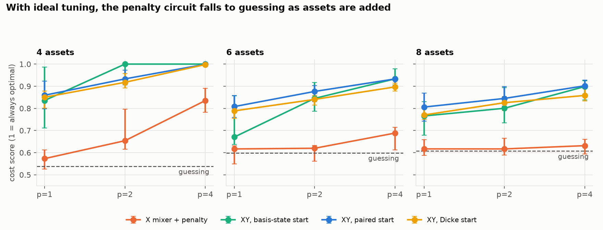
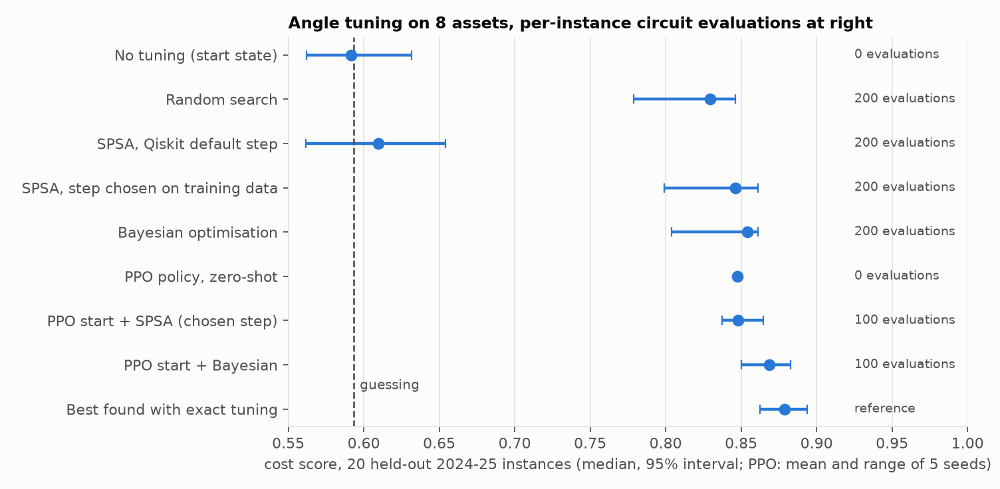
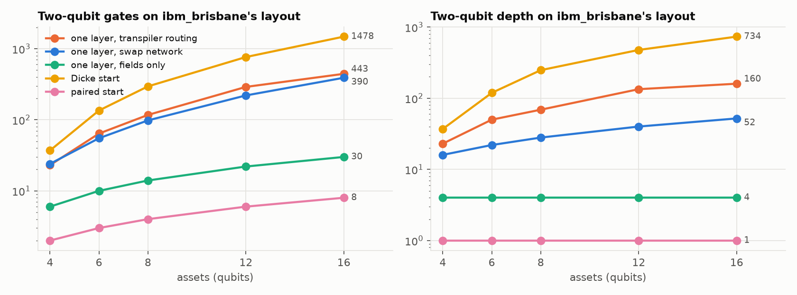
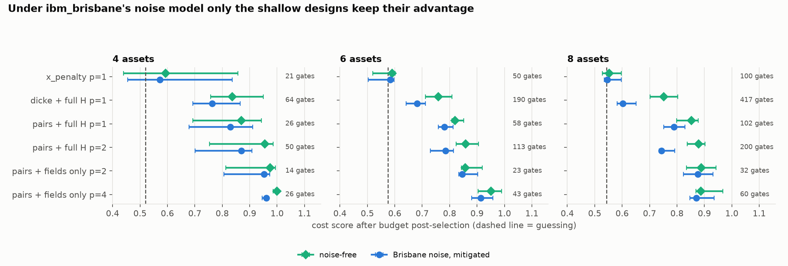
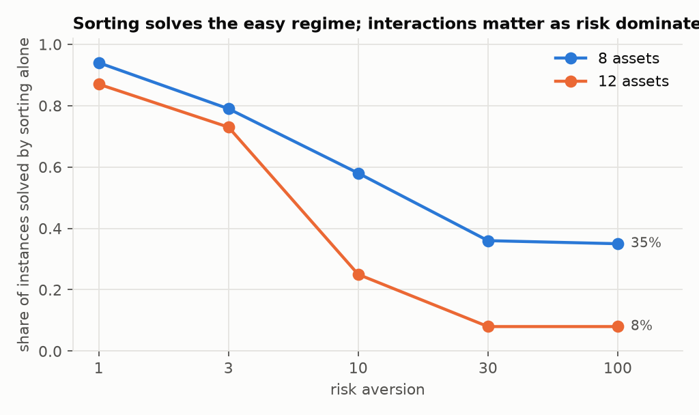

# Quantum portfolio selection with QAOA: thesis, antithesis, synthesis

Qiskit Fall Fest 2026 (Miami Dade College). Theme: quantum portfolio optimisation.

**One sentence, no physics:** a fund must hold exactly half of a list of stocks; we test whether a
quantum circuit can pick a low-risk, high-return half, we fix the reasons the textbook circuit cannot,
and we report honestly that a sort plus a short classical search still wins at every size we can run.

**Nothing here ran on a real quantum computer.** The theme names IBM's 127-qubit `ibm_brisbane`, which
was retired on 2025-11-03. Every "Brisbane" number is a noisy simulation using `FakeBrisbane`, IBM's
snapshot of that device's layout, gates and calibration. `qpo.hardware.get_backend("<name>")` accepts a
live backend, but that path is untested.

Start with `quantum_portfolio_qaoa.ipynb` (already executed, about a minute to re-run).

## The problem and who it matters to

Mean-variance selection: choose *B* of *n* stocks, equally weighted, to minimise
`risk_aversion × variance − return`. Asset managers solve versions of this at every rebalance. The
number of choices grows fast (12,870 for 8 of 16; over 10^17 for 30 of 60). Data: daily closes of 16
US large caps, 2021-01-04 to 2025-12-30 (`data/prices.csv`, from Yahoo Finance). Each instance is a
random set of stocks over a random one-year window.

## Method

Each design claim (thesis) is attacked with a check that could fail (antithesis); only what survives is
kept (synthesis).

| Thesis | Antithesis (what we checked) | Synthesis |
|---|---|---|
| The Hamiltonian is the cost function. | Brute force over every bitstring. A rebuild of two reviewed defects is off by 8.05, the dropped constant λB² = 8. | Corrected build matches to 1e-15; the check is a test. |
| Textbook QAOA (X mixer + budget penalty) just needs better tuning. | Give it exact, ideal tuning and a penalty weight chosen knowing the answer. At 8 stocks it scores 0.62–0.63; guessing scores 0.61. | The failure is structural. Use an XY mixer, which cannot break the budget. |
| The XY circuit scores 100% at depth 1 on the toy. | Its fixed start state was the optimum; zero angles gives 100%. | Use start states that favour no stock, on instances with random stock order. |
| The Dicke start is the right unbiased start. | On Brisbane's layout it costs 295 two-qubit gates at 8 stocks, more than the QAOA layer. | A paired start (one entangled pair per two stocks) costs 4 and scores the same or better on cost. |
| Let the transpiler route the swap network. | At optimisation levels 2–3 Qiskit removes explicit SWAPs and re-routes, undoing it. | Fuse each ZZ+SWAP into one block; counts then match theory exactly (98 at 8 stocks). |
| SPSA is a poor tuner here. | Qiskit's default step is sized for raw angles, and our neutral start is a stationary point. | With a step chosen on training instances SPSA is competitive. Both rows are reported. |
| The problem needs a combinatorial solver. | After an exact rewrite, sorting solves 73–94% of instances at ordinary risk aversion (1–3). | Benchmark at risk aversion 30, where interactions matter most; say plainly that classical search still solves it. |

## Results

All instances below are from 2024–25 windows; anything fitted (the PPO policy, SPSA's step) saw only
2021–23. "Cost score" is 1 if a circuit always returns the optimum and 0 if it always returns the worst
valid portfolio. Intervals are 95% percentile bootstraps over instances.

**1. Circuit design, ideal tuning, 8 stocks, 20 instances** (`e02`)

| Circuit | depth 1 | depth 2 | depth 4 |
|---|---|---|---|
| X mixer + penalty | 0.617 | 0.617 | 0.632 [0.594, 0.661] |
| XY, basis-state start | 0.766 | 0.800 | 0.898 |
| XY, paired start | 0.806 | 0.845 | 0.902 [0.865, 0.927] |
| XY, Dicke start | 0.770 | 0.826 | 0.858 |
| uniform guessing | 0.607 | | |

Caveat: cost score and "probability of the exact optimum" disagree. At depths 1–2 the paired start is
*less* likely than guessing to return the exact optimum (0.3–0.4× guessing) while the Dicke start is
3–4.4× guessing; at depth 4 both are about 5×.



**2. Angle tuning, 8 stocks, depth 4, 1024-shot objective, 20 instances** (`e03`, `e03b`)

| Tuner | Evaluations per instance | Cost score |
|---|---|---|
| none (start state) | 0 | 0.592 |
| random search | 200 | 0.829 [0.779, 0.846] |
| SPSA, Qiskit default step | 200 | 0.610 [0.562, 0.654] |
| SPSA, step chosen on training data | 200 | 0.846 [0.799, 0.861] |
| Bayesian optimisation (GP + expected improvement) | 200 | 0.854 [0.804, 0.861] |
| **PPO policy, zero-shot** | **0** | **0.847 (range over 5 seeds 0.847–0.848)** |
| PPO start + Bayesian optimisation | 100 | 0.869 [0.850, 0.883] |
| best found with exact tuning | reference | 0.879 |

The PPO policy matches 200-evaluation tuners with no per-instance evaluations. Its cost is paid once,
offline: 30,000 simulator evaluations (about 25 s). Trained on 8 stocks, it scores 0.845 on 10 and
0.835 on 12 (exact tuning: 0.869, 0.863). Feeding it instance features did not help: a policy with no
inputs scores the same on 8 and slightly better on 10 and 12 (0.855), so what PPO learned is one good
angle schedule for this family of problems, not instance-specific tuning.



**3. Brisbane layout and noise** (`e04`; median ECR error in the snapshot 0.77%)

Two-qubit gates for one QAOA layer at 8 / 16 stocks: transpiler routing 117 / 443 (depth 69 / 160),
swap network 98 / 390 (depth 28 / 52), fields only 14 / 30 (depth 4). Start states: Dicke 295 / 1478,
paired 4 / 8.



Noisy simulation, 8 stocks, 5 instances, 4096 shots, cost score after budget post-selection:

| Design | 2-qubit gates | Noise-free | Brisbane noise | Shots kept |
|---|---|---|---|---|
| X mixer + penalty, depth 1 | 100 | 0.553 | 0.546 | 46% |
| Dicke + full cost layer, depth 1 | 417 | 0.752 | 0.603 | 31% |
| paired + full cost layer, depth 1 | 102 | 0.853 | 0.789 | 58% |
| paired + full cost layer, depth 2 | 200 | 0.879 | 0.744 | 44% |
| paired + fields only, depth 2 | 32 | 0.889 | 0.876 | 76% |
| paired + fields only, depth 4 | 60 | 0.888 | 0.871 | 65% |
| uniform guessing | | 0.543 | | |

Readout mitigation recovered up to 7 points of valid shots but changed the post-selected score by about
0.005 at most: a readout flip changes the number of held stocks, so post-selection already removes it.



**4. Against classical methods, risk aversion 30, 40 instances** (`e05`)

| Method | Cost evaluations (16 stocks) | Optimum found: 8 | 12 | 16 stocks |
|---|---|---|---|---|
| sort by gauge field + swap search | 193 | 100% | 98% | 98% |
| simulated annealing | 401 | 100% | 98% | 95% |
| Markowitz weights, rounded | 174 | 58% | 30% | 0% |
| 1024 uniformly random valid portfolios | 1024 | 100% | 60% | 10% |
| QAOA (noise-free simulator, PPO angles), 1024 shots | 1024 | 100% | 85% | 53% |

QAOA sampling beats random sampling at equal shots. It does not beat a sort followed by a short local
search, which uses about a fifth of the evaluations and no quantum computer.



## Why quantum, and what we do not claim

- **No quantum advantage is shown or implied.** Every instance here is solved exactly by brute force,
  and near-exactly by a few hundred classical cost evaluations.
- **The hardware-friendly circuit is classically simulable.** With the couplings dropped, the circuit
  is XX+YY gates between neighbours plus Z rotations on a line: a free-fermion (matchgate) circuit,
  which a classical computer can simulate efficiently. The residual ZZ couplings are what break that,
  and they are exactly the gates today's noise cannot afford (compare the "full cost layer" rows with
  the "fields only" rows above).
- **What would have to change:** instances where pair interactions dominate (they carry about 10% of
  the cost variation here even in the risk-dominated regime), at sizes beyond classical local search,
  on hardware with two-qubit error low enough for hundreds of gates at useful depth. None of the three
  holds today for this problem.
- **What quantum is doing here:** the XY mixer keeps the state inside the set of valid portfolios and
  interference shifts probability toward low-cost ones. That is real and measured (0.54 → 0.88 under
  noise at 8 stocks). It is not a speedup.

## Limits of the evaluation

- Instances share 16 tickers and overlapping windows, so they are not independent and the intervals
  are narrower than they should be. Noisy runs use only 5 instances per size.
- Nothing was pre-registered. The paired start, the risk-aversion setting and PPO's hyperparameters
  were chosen after exploratory runs that used test-period windows. The tuner benchmark then used a
  fresh held-out pool, but the design choices themselves are exploratory.
- "Ideal tuning" is the best of 6–8 optimiser restarts, a lower bound on what each circuit can do.
- Bayesian optimisation and PPO hyperparameters were not tuned; SPSA's step was (on training data).
- The noise model is Markovian. Crosstalk and drift on a real device are not captured, and dynamical
  decoupling, which targets those, was not tested for that reason.
- Mean returns estimated from one year of prices are noisy; this is a selection benchmark, not
  investment advice.

## Layout

| Path | Contents |
|---|---|
| `qpo/problem.py` | The cost function and brute-force tables. Source of truth. |
| `qpo/hamiltonian.py` | QUBO → Ising, budget gauge, brute-force `verify`. |
| `qpo/ansatz.py`, `qpo/dicke.py` | X- and XY-mixer circuits, start states, Fourier schedule. |
| `qpo/fastsim.py` | NumPy simulator for tuning loops, tested against Qiskit's `Statevector`. |
| `qpo/tuners.py`, `qpo/ppo.py` | Random search, SPSA, Bayesian optimisation, PPO policy. |
| `qpo/hardware.py`, `qpo/mitigation.py` | Qubit-line selection, swap network, transpilation, `SamplerV2` runs, readout mitigation, post-selection. |
| `qpo/classical.py` | Classical baselines. |
| `experiments/` | `e01`–`e05` write `results/*.json`; `make_figures.py`; `build_notebook.py`. |
| `tests/` | 132 tests. |

## Reproduce

```bash
uv venv --python 3.12 .venv && uv pip install --python .venv/bin/python -r requirements.txt
.venv/bin/python -m pytest tests -q
for s in e01_hamiltonian_check e02_ansatz_ceiling e03_tuners e03b_spsa_fair_start e04_hardware e05_classical make_figures build_notebook; do .venv/bin/python experiments/$s.py; done
```

Versions: Qiskit 2.6.2, qiskit-aer 0.18.2, qiskit-ibm-runtime 0.52.0, stable-baselines3 2.9.2.
Total runtime is about 20 minutes on a laptop. PPO training is seeded but not bit-reproducible across
machines.

## What we built and what we reused

Built: the cost/Hamiltonian check, the budget gauge, the XY circuits and paired start, the swap-network
builder and line selection, the fast simulator, the Bayesian optimiser, the PPO environment, the
mitigation code and all experiments. Reused: Qiskit's `qaoa_ansatz`, transpiler, `SamplerV2`, Aer noise
model and `FakeBrisbane`; `qiskit-algorithms`' SPSA; stable-baselines3's PPO; scikit-learn's Gaussian
process. The Dicke circuit follows Bärtschi and Eidenbenz (2019); the Fourier schedule follows Zhou et
al. (PRX 10, 021067).

## With another month

Run the 32-gate design on a live IBM backend; keep only the strongest residual couplings along the
qubit line (the step between "simulable" and "too deep"); test real constraints (sector caps,
transaction costs) that add genuine interactions; pre-register the next benchmark.
